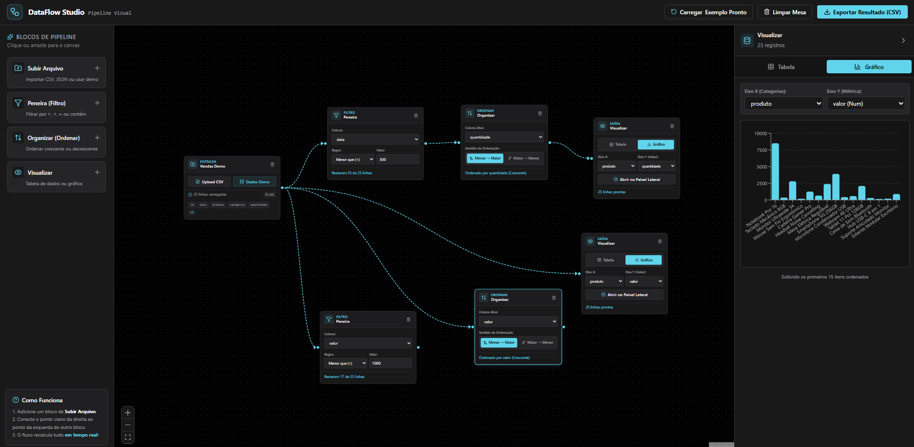

# ⚡ DataFlow Studio — Pipeline Visual

> Uma interface no-code / low-code baseada em nós para importação, manipulação, filtragem e visualização de dados em tempo real.


*(Dica: salve o print da sua tela com o nome `preview.png` na raiz do projeto para aparecer aqui)*

---

## 📌 Sobre o Projeto

O **DataFlow Studio** é uma ferramenta interativa desenvolvida para simplificar a análise e transformação de dados tabulares. Inspirado em ferramentas modernas de ETL e nós visuais, o projeto permite que qualquer pessoa crie fluxos de dados conectando blocos de entrada, filtros condicionais, ordenações e painéis gráficos interativos — tudo recalculado em tempo real conforme as conexões são feitas.

---

## ✨ Funcionalidades Principais

- **Mesa de Trabalho Interativa (Canvas):** Arraste, conecte, mova e reorganize blocos livremente.
- **Cálculo em Tempo Real:** Cada alteração em um filtro ou nova conexão reflete imediatamente nos nós seguintes da cadeia.
- **Múltiplos Caminhos (Branching):** Conecte uma mesma fonte de dados a diferentes regras de filtragem e gere visões analíticas simultâneas.
- **Painel Lateral Analítico:** Visualize tabelas completas ou gráficos de barras customizáveis (configuração dinâmica de Eixo X e Eixo Y).
- **Atalhos Rápidos:**
  - Carregar exemplo pronto com um clique.
  - Limpar mesa de trabalho.
  - Exportar os dados processados diretamente em **CSV**.

---

## 🧱 Blocos de Pipeline Disponíveis

| Bloco | Tipo | Descrição |
| :--- | :--- | :--- |
| 📥 **Subir Arquivo** | Entrada | Upload de arquivos `.csv`, `.json` ou carregamento de base de demonstração integrada. |
| 🍸 **Peneira** | Filtro | Aplicação de regras condicionais (`>`, `<`, `=`, `contém`) sobre qualquer coluna da base. |
| ⇅ **Organizar** | Ordenação | Ordenação de registros em ordem crescente ou decrescente com base em colunas numéricas ou texto. |
| 👁️ **Visualizar** | Saída | Inspeção tabular ou geração de gráficos interativos com métricas customizáveis. |

---

## 🛠️ Tecnologias Utilizadas

- **[React](https://react.dev/)** — Biblioteca para construção da interface reativa
- **[Vite](https://vitejs.dev/)** — Build tool ultra-rápida para o frontend
- **[React Flow (@xyflow/react)](https://reactflow.dev/)** — Motor interativo de nós e conexões do canvas
- **[Tailwind CSS](https://tailwindcss.com/)** — Estilização moderna e responsiva
- **Lucide Icons** — Biblioteca de ícones vetoriais

---

## 🚀 Como Executar o Projeto Localmente

### Pré-requisitos
Certifique-se de ter instalado em sua máquina:
- [Node.js](https://nodejs.org/) (versão 18 ou superior)
- Gerenciador de pacotes `npm`

### Passo a Passo

1. **Clone o repositório:**
   ```bash
   git clone https://github.com/SEU_USUARIO/NOME_DO_REPOSITORIO.git
